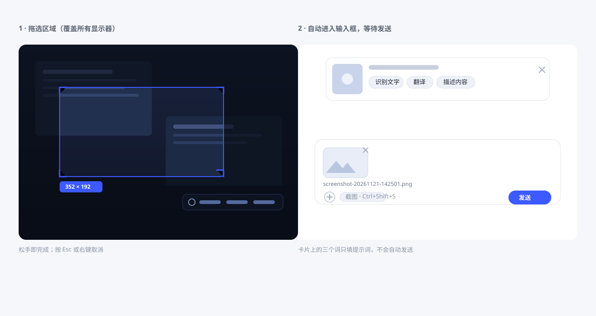

> 我是个小白，这个插件全靠 DeepSeek Harness 帮我说出来的——我描述需求、它写代码，所以下面的介绍里可能有些读起来蹩脚的地方，但功能我自己反复测过，非常合我意，希望大家喜欢～
>
> I'm a beginner, and this plugin was built entirely by telling DeepSeek Harness what I wanted — I described it, it wrote the code. So some wording below may read a little awkward; the features are ones I tested myself and am genuinely happy with. Hope you like it too.

# 3 features screenshot

A plugin for [DeepSeek Harness](https://github.com/deepseek-ai/deepseek-harness) — drag any region of any monitor, the picture lands in the composer as an attachment, and the model reads its text, translates it, or describes it. One screenshot, three things you usually want from it.



## Features

- **Any size, any monitor.** One borderless layer covers the whole virtual screen; the rectangle you drag is the only thing captured. The desktop keeps running behind a light veil — nothing is frozen, and nothing is grabbed behind your back when you click.
- **Lands in the composer.** The PNG is inserted as a normal image attachment and waits for you to send it. Nothing is submitted automatically.
- **Ask the model about it.** A small card offers **Read text**, **Translate**, and **Describe**, which fill in the prompt — they never send.
- **Your own shortcut.** `Ctrl+Shift+S` (`⌘⇧S`) by default, rebound like any other DSH command in **Settings → Shortcuts**.
- **Never duplicates.** If the composer refuses files while a reply is still streaming, the shot is held and retried once, instead of pasting it twice or dropping it.
- **No extra runtime.** The Host half draws the selection in one PowerShell process on Windows and calls the platform's own snipper on macOS and Linux. No native module, no bundled binary, no screenshot service.

## Install

Requires a DeepSeek Harness build that ships the plugin manager (`dsh` desktop 0.2.x or newer).

1. Clone this repository somewhere stable:

   ```sh
   git clone https://github.com/reiaaaaa/DSH-shot-reiaaaaa.git
   ```

2. In DeepSeek Harness open **Plugins → Add plugin** and pick the cloned `dsh-shot` directory.
3. Restart the app once. The Host half is loaded when the app starts, so the very first install needs a full quit and reopen; after that, edits to `client.js` reload live.

The package is a normal DSH bundle (`dsh.bundle.patch` + a browser half in `dsh.client`), so it can also be installed with the `plugin_manager` tool's `install_bundle` action pointing at the same directory.

## Use

| Step | What happens |
| --- | --- |
| Click **截图** in the composer tool row, or press `Ctrl+Shift+S` | A borderless selection layer covers every monitor |
| Drag a rectangle and release | Only that rectangle is captured |
| `Esc` or a right-click | Cancels; nothing is attached |
| The image appears in the composer | Plus a card with **Read text / Translate / Describe** |

The three card actions only write a prompt; edit it and send when you like.

### Platforms

| Platform | How the rectangle is picked |
| --- | --- |
| Windows | One PowerShell process draws a topmost form across the virtual screen, cuts the drag rectangle out of the veil, and copies that rectangle into a PNG. Clipboard untouched. |
| macOS | `screencapture -i -x -t png` — grant Screen Recording permission the first time |
| Linux | `maim -s`, `scrot -s`, `gnome-screenshot -a`, `spectacle -r`, or `import`, whichever is installed first |

## How it works

Two halves, no native code:

- **Host** (`index.js` + `windows-script.js`) registers exactly one authenticated route, `GET /api/dsh-shot.snip`, on the DSH connection fetch registry. A call runs the selection once, reads the PNG, and answers with the bytes.
- **Browser** (`client.js`) registers a trigger in `conversation.input.left` and the result card in `shell.overlay`, then hands the PNG to the composer by dispatching the same file-intake path a real paste uses. The shortcut is a `ctx.shortcuts` command, which is why rebinding comes for free.

The image never leaves the machine except as part of a message you send.

## Development

- `client.js` is a `window.__ModuleLoader__` module; `index.js` is a plain ESM Cordis plugin. No build step, no dependencies.
- `docs/DETAIL.md` is the page shown in the plugin's detail view; `locale/en.json` and `locale/zh.json` hold the metadata.
- Editing `client.js` hot-reloads the running app within a few seconds. Editing `index.js` or `windows-script.js` needs an app restart.
- The Windows script is generated, so it can be syntax-checked without opening a capture: see `windows-script.js`'s `windowsScript()` output and run it through PowerShell's parser.

## 中文说明

在输入框左边点「截图」（或按 `Ctrl+Shift+S`），在屏幕上拖出一块区域，松手后这张图会作为附件出现在输入框里，等你发送。输入框正上方浮出的卡片可以一键填入「识别文字 / 翻译 / 描述内容」的提示词——只填提示词，不会自动发送。

- 覆盖所有显示器，选区之外屏幕只是变暗，不会冻结画面；`Esc` 或右键取消。
- 快捷键和其他 DSH 命令一样，在 **设置 → 快捷键** 里改。
- 截图时如果助手还在回复，会先显示「正在插入截图…」，回复结束自动放进输入框，不会重复插入。
- 图片只用本机的临时文件转交，不会上传到任何第三方。

安装：克隆本仓库后，在 DeepSeek Harness 里打开 **插件 → 添加插件**，选择 `dsh-shot` 目录，然后完整退出并重开一次应用。

## License

MIT — see [LICENSE](LICENSE).
