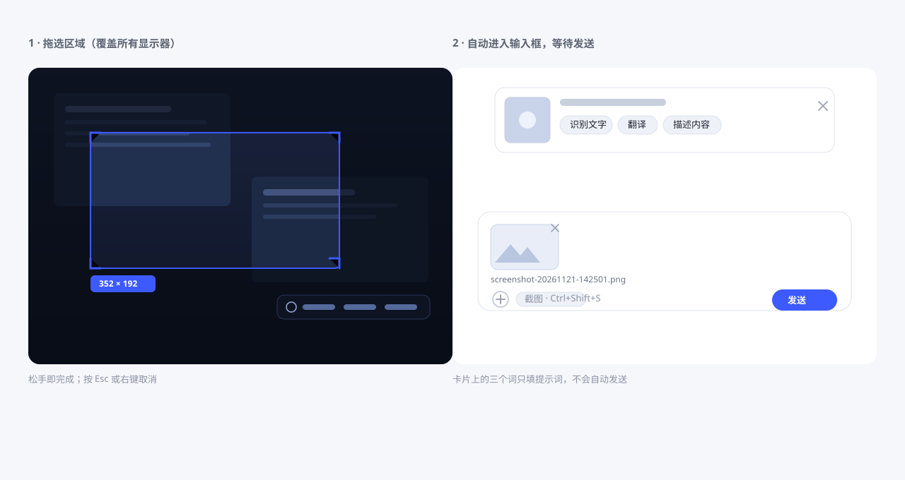

# Screenshot

Pick any rectangle on the screen, and the rectangle lands in the composer as an
image attachment, ready to send. The desktop keeps running while you pick — the
plugin never freezes the screen and never shoots the whole display behind your
back.

## Taking a screenshot

- Click **截图** in the composer tool row, or press **Ctrl+Shift+S**
  (**⌘⇧S** on macOS).
- The selection layer covers every monitor at once, so the rectangle can reach any
  window on any display, not just this one.
- The screen dims slightly and the area you drag stays fully visible, because the
  desktop keeps updating behind the veil while you pick.
- Drag the rectangle you want and release. Only that rectangle is captured.
- **Esc** or a right-click cancels; the page then says **已取消截图** and nothing is
  attached. After 90 seconds without a pick the overlay closes by itself.

The finished screenshot appears twice: as a normal attachment in the composer, and
in a small card at the top of the page with three shortcuts for the model.

## Asking the model about it

| Action | What it writes into the composer |
| --- | --- |
| **Read text** | Asks for the text in the screenshot, in reading order, original line breaks, no translation |
| **Translate** | Asks for the original text followed by a translation |
| **Describe** | Asks for a description of what the screenshot shows |

Each action only fills the prompt — it never sends. Type the rest of your question
if you want, then send when you are ready. If the composer already has text, the
prompt is inserted at the cursor instead of replacing the draft.

The three words are also ordinary questions: you can ignore the card and just type
"翻译一下这张图" yourself.

## When the reply is still streaming

The composer refuses new files while a reply is still streaming. Instead of
dropping the shot, the plugin keeps it and retries: the pill at the top says
**Inserting the screenshot…** until a thumbnail appears in the composer, which
happens the moment the reply finishes. After two minutes without admission the
shot is dropped with a notice, so nothing is pasted twice.

## Changing the shortcut

The shortcut is a normal DSH command (`dsh-shot.capture`), so it is rebound the
same way as any other:

1. Open **Settings → Shortcuts**.
2. Find **Take a screenshot** and record a new key combination.

The new binding is saved with the rest of your keybindings (desktop:
`keybindings.json` in the app's user data; web: the browser profile) and the
button tooltip follows it. The Web edition only accepts combinations the browser
lets a page see, so two modifiers including the primary one is the safe shape.

## How the capture works, per platform

The Host process draws the selection itself (Windows) or runs the platform's own
snipper (macOS, Linux), so no extra runtime, no bundled native code, and no
third-party screenshot service.

| Platform | Mechanism |
| --- | --- |
| Windows | one PowerShell process draws a borderless topmost window over the whole virtual screen; the veil is cut open under the drag rectangle, and the rectangle is copied straight out of the desktop into a PNG |
| macOS | `screencapture -i -x -t png` (interactive selection) |
| Linux | `maim -s`, `scrot -s`, `gnome-screenshot -a`, `spectacle -r`, or `import`, whichever is installed first |

Notes:

- On Windows nothing touches your clipboard, and the overlay spans every monitor.
- On macOS the system asks for the Screen Recording permission the first time;
  grant it to DeepSeek Harness and capture keeps working from then on.
- The Linux helpers may dim the screen themselves while you drag; that dimming is
  theirs, not the plugin's.

## Privacy

- One PNG per screenshot, written to a private temporary directory and deleted
  immediately after it is read.
- The image only travels from the Host process to this page over the app's own
  authenticated route. Nothing is uploaded to a third party by the plugin.
- The image becomes part of your message only when you send it, exactly like a
  file you attach by hand.
